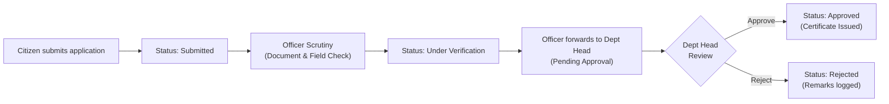
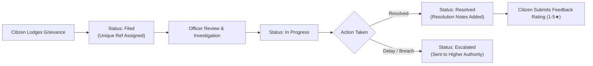

# National E-Governance Portal (NEGP)

[](https://nodejs.org/)
[](https://expressjs.com/)
[](https://nodejs.org/api/sqlite.html)
[]()
[](LICENSE)

A unified, full-stack digital e-governance platform designed to streamline public service delivery, automate multi-tier citizen application workflows, enforce role-based administrative scrutiny, and provide transparent public grievance redressal.

---

## 📌 Overview

The **National E-Governance Portal (NEGP)** serves as a single-window digital interface bridging citizens and government departments. The platform facilitates end-to-end digital governance across revenue, civil supplies, transport, public health, and vital statistics.

Built on an asynchronous Express REST backend and a responsive Single-Page Architecture (SPA) frontend, the system enforces **Role-Based Access Control (RBAC)**, formal separation of duties between verifying officers and approving heads, document verification, audit logging, and automated SLA tracking.

---

## ✨ Key Features

- **🏛️ Unified Citizen Service Directory**: Comprehensive catalog of government services (Income Certificate, Domicile Certificate, Driving License Renewal, Ration Card, Birth Registration) detailing required documentation, processing turnaround, and statutory fees.
- **📑 Multi-Tier Application Lifecycle**: Multi-stage state machine enforcing strict scrutiny:
  $$\text{Draft} \longrightarrow \text{Submitted} \longrightarrow \text{Under Verification} \longrightarrow \text{Pending Approval} \longrightarrow \text{Approved / Rejected}$$
- **⚖️ Public Grievance Redressal System (PGRS)**: Transparent grievance lodgment, automatic tracking reference generation (`NEGP-GRV-XXXXXX`), officer investigation updates, escalation handling, and post-resolution citizen feedback rating (1–5 stars).
- **👥 Role-Based Access Control (RBAC)**: Segregated interfaces and execution rights for **Citizens**, **Government Officers**, **Department Heads**, and **System Administrators**, complete with a real-time role simulator for testing and demonstrations.
- **📊 Real-Time Operations & Analytics Dashboard**: Live metrics summarizing total submissions, verification throughput, approval rates, resolved grievances, and department distributions.
- **🛡️ Audit Logging & Data Integrity**: SQLite relational schema with foreign key constraints, parameterized queries, file upload sanitation, and timestamped administrative audit trails.
- **🧪 Automated Verification Suite**: 24 automated test cases covering Boundary Value Analysis (BVA), Equivalence Partitioning (EP), authorization constraints, and integration flows.

---

## 🏛️ System Architecture & Workflow

### 1. Application Processing Lifecycle


### 2. Grievance Redressal Lifecycle


---

## 👥 Role-Based Access Control Matrix

| Role | Permissions & Functional Scope | Default View |
| :--- | :--- | :--- |
| **Citizen** | Browse service catalog, apply for certificates, upload proof documents, track live application timeline, lodge grievances, submit satisfaction ratings. | Citizen Portal & Service Directory |
| **Government Officer** | Access departmental queue, scrutinize applicant proofs, transition applications to *Under Verification*, add officer remarks, recommend for *Pending Approval*, investigate and resolve grievances. | Officer Scrutiny Queue |
| **Department Head** | Executive oversight, final approval/rejection authority, issue certificates, inspect escalated grievances, monitor department compliance. | Approval Desk & Department View |
| **System Administrator** | System-wide configuration, comprehensive audit logs, real-time analytics, user role administration, master service catalog. | Administrative Analytics & Audit |

---

## 🚀 Getting Started

### Prerequisites
- **Node.js**: v20.0.0 or higher (Native SQLite `node:sqlite` support)
- **npm**: v9.0.0 or higher

### Installation & Launch

1. **Clone the repository:**
   ```bash
   git clone https://github.com/Abhishekp0106/National-E-Governance-Portal.git
   cd National-E-Governance-Portal
   ```

2. **Install dependencies:**
   ```bash
   npm install
   ```

3. **Start the application:**
   ```bash
   npm start
   ```

4. **Access the Portal:**
   Open your browser and navigate to:
   ```
   http://localhost:3000
   ```
   *(The database is automatically initialized and seeded with pre-configured departments, services, sample records, and demo role accounts on first launch).*

---

## 🔑 Pre-Configured Demo Accounts

For demonstration and evaluation, switch between roles using the **Active Role** dropdown in the navigation header, or sign in directly with the following credentials:

| Role | Name | Email | Password | Department Scope |
| :--- | :--- | :--- | :--- | :--- |
| **Citizen** | Abhishek Purohit | `abhishek.citizen@negp.gov.in` | `Password@123` | General Citizen |
| **Government Officer** | Rajesh Sharma | `rajesh.officer@negp.gov.in` | `Officer@123` | Revenue & Land Records (`REV`) |
| **Department Head** | Dr. Sunita Verma | `sunita.head@negp.gov.in` | `Head@123` | Revenue & Land Records (`REV`) |
| **Administrator** | Admin Portal Officer | `admin@negp.gov.in` | `Admin@123` | Portal-Wide Authority |

---

## 📁 Repository Structure

```
├── public/
│   ├── index.html          # Responsive single-page application UI
│   ├── style.css           # Custom theme, glassmorphic cards & responsive grid
│   └── app.js              # Client controller, state management & API integration
├── src/
│   ├── database.js         # SQLite connection & relational schema definitions
│   ├── seed.js             # Initial database seeder for services, departments & users
│   └── server.js           # Express 5 REST API routes, controllers & static server
├── tests/
│   └── test_suite.js       # 24-point automated integration & validation test suite
├── .gitignore              # Git exclusions for dependencies, databases & uploads
├── package.json            # Project manifest, scripts & dependencies
└── README.md               # Project documentation
```

---

## 🔌 API Reference Overview

### Public & Authentication
- `POST /api/auth/register` — Citizen self-registration
- `POST /api/auth/login` — User authentication and role retrieval
- `GET  /api/services` — List catalog of government services

### Service Applications
- `POST /api/applications` — Submit application with multipart supporting documents
- `GET  /api/applications/track/:id` — Track application status and historical timeline
- `GET  /api/applications/user/:userId` — Retrieve applications filed by a specific citizen
- `GET  /api/applications/queue` — Officer/Head operational review queue (filtered by role and department)
- `POST /api/applications/verify` — Scrutiny transition (`Under Verification` / `Pending Approval`)
- `POST /api/applications/approve` — Final executive decision (`Approved` / `Rejected`)

### Public Grievances
- `POST /api/grievances` — Lodge a public grievance
- `GET  /api/grievances/track/:id` — Track grievance by reference ID
- `GET  /api/grievances/user/:userId` — Citizen's filed grievances
- `GET  /api/grievances/queue` — Officer grievance queue
- `POST /api/grievances/status` — Update grievance status & investigation notes
- `POST /api/grievances/feedback` — Submit post-resolution rating & comments

### Analytics & System Audit
- `GET  /api/analytics/dashboard` — Portal aggregate metrics and KPIs
- `GET  /api/audit-logs` — Administrative audit trail

---

## 🧪 Automated Testing

The project includes an end-to-end automated test suite covering:
- **Boundary Value Analysis (BVA)**: Phone number digit boundaries, grievance description length limits, star rating range limits ($1 \le \text{stars} \le 5$).
- **Equivalence Partitioning (EP)**: Valid vs. invalid email formats, missing mandatory application fields, unauthorized cross-role approvals.
- **Role-Based Access Enforcement**: Verifying that officers cannot perform final approvals, only department heads.
- **Workflow State Transitions**: Full lifecycle progression from submission to approval and feedback closure.

To execute the test suite:
```bash
npm test
```

### Test Results Summary:
```text
===============================================================
  STARTING COMPREHENSIVE AUTOMATED TEST SUITE FOR NEGP        
===============================================================
[PASS] TC-M1-01 - Register citizen with valid credentials
[PASS] TC-M1-02 - Attempt registration with existing email
[PASS] TC-M1-03 - Submit registration with missing mandatory fields
[PASS] TC-M1-04 - BVA on mobile phone: 9 digits (Min - 1)
[PASS] TC-M1-05 - Login with valid citizen credentials
[PASS] TC-M1-06 - Login with incorrect password
[PASS] TC-M1-07 - Retrieve catalog of available government services
[PASS] TC-M1-08 - Submit complete government service application
[PASS] TC-M1-09 - Submit application with incomplete mandatory fields
[PASS] TC-M1-10 - Track submitted application and view status history timeline
[PASS] TC-M1-11 - Government Officer transitions application to Under Verification
[PASS] TC-M1-12 - Transition application to Pending Approval
[PASS] TC-M1-13 - Enforce Dept Head approval authority (Prevent officer from approving)
[PASS] TC-M1-14 - Department Head approves application and grants service
[PASS] TC-M2-01 - Lodge public grievance with valid category and details
[PASS] TC-M2-02 - Submit grievance with missing required fields
[PASS] TC-M2-03 - BVA on grievance title: 4 characters (Min - 1)
[PASS] TC-M2-04 - Track grievance by reference ID and verify details
[PASS] TC-M2-05 - Officer acknowledges and transitions grievance to In Progress
[PASS] TC-M2-06 - Officer resolves grievance with comprehensive resolution remarks
[PASS] TC-M2-07 - Submit 5-star resolution feedback
[PASS] TC-M2-08 - BVA on feedback rating: 6 stars (Max + 1)
[PASS] TC-M2-09 - Query invalid / nonexistent grievance ID
[PASS] TC-SYS-01 - Verify dashboard metrics and real-time status counts
===============================================================
TEST SUMMARY: Total=24 | Passed=24 | Failed=0
===============================================================
```

---

## 📄 License

This project is licensed under the [MIT License](LICENSE).

## 👤 Author

**Abhishek Purohit**  
- GitHub: [@Abhishekp0106](https://github.com/Abhishekp0106)
